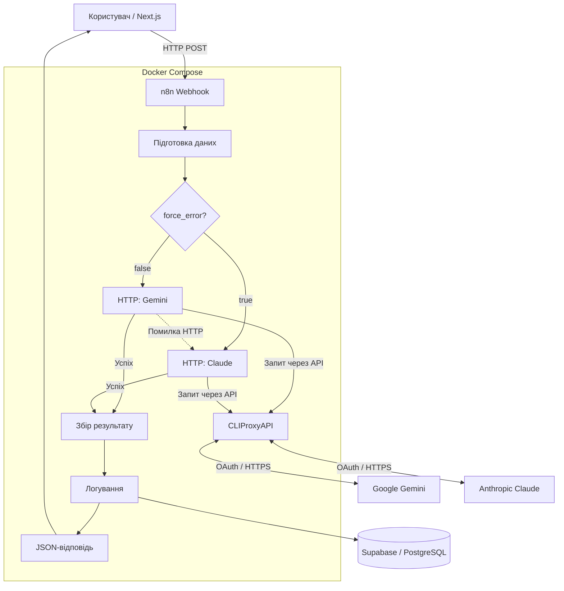
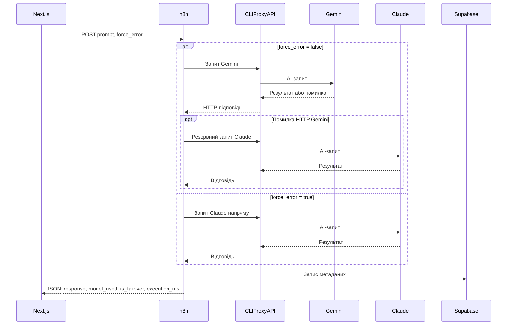

# Smart AI Failover — MVP

Відмовостійка система обробки AI-запитів з автоматичним перемиканням між Gemini та Claude.

**Підключення через OAuth** — через [CLIProxyAPI](https://help.router-for.me), який обгортає Gemini CLI та Claude Code як OpenAI-сумісний API.

---

## Швидкий старт

### Крок 1 — Запусти Docker

Перед запуском налаштуй змінні SUPABASE_DB_HOST, SUPABASE_DB_PASSWORD, SUPABASE_URL та SUPABASE_SERVICE_KEY у локальному .env. Не додавай секрети до Git. Застосуй схему supabase/schema.sql у Supabase. Для браузерного доступу перевір NEXT_PUBLIC_WEBHOOK_URL: внутрішнє ім'я n8n доступне лише в Docker-мережі.

```bash
git clone https://github.com/sarccasm/smart-ai-failover.git
cd smart-ai-failover
docker compose up -d
```

### Крок 2 — Авторизуй Gemini

```bash
docker compose exec cli-proxy-api /CLIProxyAPI/CLIProxyAPI --no-browser --login
```

Відкриється URL — скопіюй його в браузер, увійди через Google акаунт. Готово.

### Крок 3 — Авторизуй Claude

```bash
docker compose exec cli-proxy-api /CLIProxyAPI/CLIProxyAPI --no-browser --claude-login
```

Відкриється URL — увійди через Anthropic акаунт.

### Крок 4 — Завантаж n8n workflow

1. Відкрий http://localhost:5678 (логін: `admin` / пароль: `changeme`)
2. **Workflows → Import from File**
3. Вибери `n8n/workflow.json`
4. Активуй workflow (toggle зверху праворуч)

### Крок 5 — Відкрий фронтенд

http://localhost:3000 — після налаштування сервісів.

---

## Запуск тестів

```bash
cd frontend
npm install

# Unit тести
npm test

# E2E тести
npx playwright install --with-deps
npm run test:e2e
```

---

## Архітектура



## Сценарії роботи Failover



## Зв'язок із хмарними технологіями

| Компонент | Принцип | Реалізація |
|---|---|---|
| Docker Compose | Контейнеризація | Окремі контейнери frontend, n8n, CLIProxyAPI |
| Gemini / Claude | Віддалені обчислення | Обробка AI-запитів зовнішніми провайдерами |
| n8n | Оркестрація | Webhook, маршрутизація, обробка помилок |
| Failover | Відмовостійкість | Резервний AI-провайдер |
| Supabase | Хмарна база даних | PostgreSQL та REST API |
| HTTP / JSON | Мережева взаємодія | Обмін даними між компонентами |
| OAuth | Авторизація | Підключення AI-провайдерів |

### 1. Контейнеризація

Фрагмент [docker-compose.yml](docker-compose.yml):

```yaml
frontend:
  build:
    context: ./frontend
    dockerfile: Dockerfile
  ports:
    - "3000:3000"
  depends_on:
    - n8n
  restart: unless-stopped
```

Контейнери ізолюють сервіси, а політика restart забезпечує їх повторний запуск після зупинки. Архітектура придатна для перенесення на хмарний сервер після налаштування мережі та секретів.

### 2. HTTP API

Фрагмент [api.ts](frontend/src/lib/api.ts):

```typescript
const res = await fetch(webhookUrl, {
  method: "POST",
  headers: { "Content-Type": "application/json" },
  body: JSON.stringify({ prompt, force_error: forceError }),
});
```

### 3. Автоматичне перемикання

У [workflow.json](n8n/workflow.json) для HTTP-вузла Gemini задано:

```json
"onError": "continueErrorOutput"
```

Workflow передбачає перехід до Claude через гілку помилки. Тайм-аут HTTP-запиту становить 15 секунд. Параметр force_error дозволяє окремо продемонструвати резервний маршрут, оминаючи Gemini.

### 4. Моніторинг

У [schema.sql](supabase/schema.sql) визначено таблицю ai_requests та представлення ai_stats.

```sql
SELECT * FROM ai_stats;
```

Метрики: кількість запитів, частота failover, використані моделі та середній час виконання.

## Демонстрація

| Сценарій | Gemini | Claude | Очікуваний результат |
|---|---|---|---|
| Звичайний запит | Успіх | Не викликається | model_used: gemini |
| Примусовий failover | Пропущено | Успіх | model_used: claude |
| Помилка HTTP Gemini | Помилка | Успіх | is_failover: true |

Це очікувані сценарії, а не результати фактичного тестування.

## Обмеження MVP

- Локальний Docker Compose не є підтвердженням розгортання у хмарі.
- Failover захищає від окремих помилок AI-провайдера, але не від відмови всього n8n або CLIProxyAPI.
- Помилка парсингу відповіді Gemini не має окремої резервної гілки.
- Перед публічним розгортанням потрібно налаштувати HTTPS, секрети, доступний браузеру URL webhook та перевірити сумісність workflow з версією n8n.
- Доступність і вартість моделей залежать від умов та лімітів провайдерів.

## Структура проекту

```
smart-ai-failover/
├── docker-compose.yml
├── cliproxyapi/
│   └── config.yaml           # Конфіг CLIProxyAPI проксі
├── frontend/
│   ├── Dockerfile
│   ├── package.json
│   └── src/
│       ├── app/page.tsx
│       ├── components/
│       │   ├── RequestForm.tsx
│       │   ├── ResponseCard.tsx
│       │   ├── HistoryTable.tsx
│       │   └── StatsBar.tsx
│       └── lib/
│           ├── api.ts
│           └── types.ts
├── n8n/
│   └── workflow.json          # n8n workflow (імпортувати вручну)
├── supabase/
│   └── schema.sql             # Схема БД
└── tests/
    ├── unit/components.test.tsx
    └── e2e/failover.spec.ts
```

## Ключові рішення

- **CLIProxyAPI** замість платних ключів: проксі використовує OAuth-сесії Gemini CLI та Claude Code ; доступ залежить від умов провайдерів.
- **OpenAI-сумісний формат**: обидва провайдери викликаються через `/v1/chat/completions` — n8n workflow простий і однаковий для обох.
- **Failover логіка в n8n**: `onError: continueErrorOutput` на ноді Gemini — при збої автоматично переходить до Claude.
- **Supabase**: логує кожен запит із часом виконання та метаданими (якщо налаштований).
